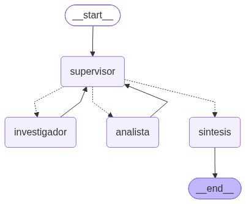
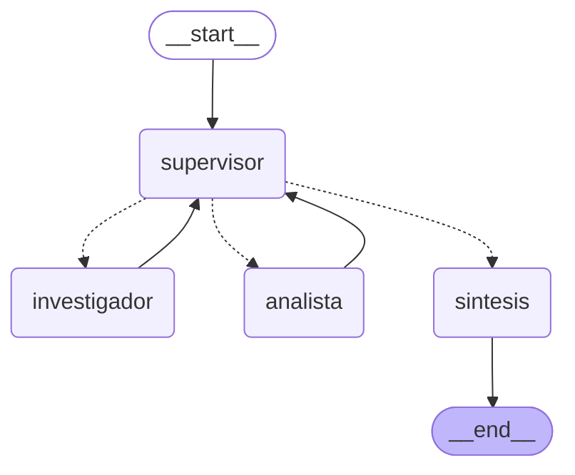

# Orquestador multi-agente: Reglamento del Edificio Riesco 6540

Pre-entrega 6 del curso de AI Engineering (CoderHouse).

La idea de este proyecto es simple: un vecino hace una pregunta sobre el reglamento de copropiedad del edificio (por ejemplo, *"¿cuántas horas a la semana se permiten mudanzas?"*) y un equipo de agentes la resuelve repartiéndose el trabajo. Uno busca en el reglamento, otro hace los cálculos y un supervisor decide quién trabaja en cada momento, revisa lo que entregan y da por terminada la tarea cuando la respuesta está completa.

Para la búsqueda reutilicé el sistema RAG híbrido (BM25 + Pinecone) que armé en la Pre-entrega 4, con los mismos documentos del reglamento.

---

## Cómo se ve el grafo



El mismo diagrama en Mermaid (lo genera `graph.py` con `app.get_graph().draw_mermaid()`):



Las flechas punteadas son las aristas condicionales: el supervisor elige uno de los tres caminos en cada vuelta. Las flechas continuas son fijas: cada especialista, cuando termina, siempre le devuelve el control al supervisor.

## Por qué elegí una topología jerárquica

Pensé en dos alternativas antes de decidirme:

- **Un pipeline fijo** (investigador → analista → respuesta). Es lo más simple, pero obliga a pasar por el analista incluso cuando la pregunta no tiene nada que calcular ("¿puedo tener mascota?"), y no deja espacio para corregir un aporte que llegó incompleto.
- **Agentes que conversan entre ellos** sin un coordinador. Es más flexible, pero se vuelve difícil saber quién decidió qué y es fácil que entren en un ida y vuelta sin fin.

La jerarquía queda al medio: los especialistas solo hacen su parte y el supervisor es el **único** que decide el flujo. Eso me da tres cosas que me importaban:

1. **Trazabilidad:** cada decisión queda registrada con su razón, y cada aporte queda asociado al agente que lo hizo.
2. **Flexibilidad:** el supervisor puede saltarse al analista, pedir que alguien corrija su trabajo o terminar antes.
3. **Un solo punto de control:** si algo sale mal, sé dónde mirar.

## Las piezas

```
ai_eng_m6/
├── state.py               # Estado compartido del grafo (AgentState)
├── graph.py               # Construcción del StateGraph y exportación del diagrama
├── main.py                # Punto de entrada: ejecuta el orquestador con una pregunta
├── demo.ipynb             # Demostración del flujo de delegación
├── agents/
│   ├── tools.py           # Herramientas: búsqueda en el reglamento y calculadora segura
│   ├── research_agent.py  # Agente investigador
│   ├── analyst_agent.py   # Agente analista
│   └── supervisor.py      # Nodo supervisor (router + rúbrica) y nodo de síntesis
├── config.py              # Configuración, credenciales y LLM
├── data.py / data/        # Documentos del reglamento
└── ingest.py, retrievers.py, rag_system.py, setup_index.py   # RAG de la Pre-entrega 4
```

| Agente | Qué hace | Herramienta | Qué **no** hace |
|---|---|---|---|
| **Investigador** | Busca normas, horarios, montos y plazos, y cita la fuente (archivo y sección) | `buscar_en_reglamento` (RAG híbrido) | No calcula |
| **Analista** | Hace los cálculos con los datos que entregó el investigador | `calculadora` | No busca información |
| **Supervisor** | Decide quién interviene, revisa los aportes con una rúbrica y decide cuándo terminar | — (salida estructurada) | No responde la pregunta por su cuenta |
| **Síntesis** | Redacta la respuesta final para el usuario | — | No agrega datos ni cifras nuevas |

Cada especialista tiene **solo su herramienta**. Si el analista también pudiera buscar, podría saltarse al investigador y la delegación dejaría de tener sentido.

## El estado compartido (`state.py`)

`AgentState` hereda de `MessagesState` y agrega estos campos:

| Campo | Para qué sirve | ¿Se acumula o se reemplaza? |
|---|---|---|
| `next_agent` | La última decisión del supervisor | Se reemplaza |
| `instruccion` | La tarea concreta que el supervisor le encarga al especialista | Se reemplaza |
| `razon` | Por qué el supervisor tomó esa decisión | Se reemplaza |
| `contribuciones` | Registro de quién aportó qué: `{agente, instruccion, aporte}` | **Se acumula** (`operator.add`) |
| `pasos` | Cuántas veces ha trabajado un especialista | **Se suma** (`operator.add`) |
| `task_completed` | Si el supervisor dio la tarea por terminada | Se reemplaza |

`contribuciones` es lo que permite rastrear qué agente aportó qué información sin perder contexto entre un paso y otro. Cada nodo solo agrega su aporte; nunca borra los anteriores.

En `pasos` usé un reducer en vez de que cada nodo hiciera `pasos + 1`: el nodo solo dice "trabajé una vez" (`{"pasos": 1}`) y LangGraph se encarga de sumar.

## Cómo se manejan los conflictos entre agentes

Este fue el punto donde más aprendí, porque los problemas reales aparecieron al probar y no al diseñar.

**1. El supervisor es la única autoridad.** Los especialistas nunca deciden quién sigue ni se hablan entre ellos. Si el investigador y el analista no calzan, el supervisor es quien lo detecta y corrige.

**2. Rúbrica de validación antes de terminar.** El supervisor revisa cuatro criterios antes de responder `FINISH`:

1. **Datos con fuente:** el investigador entregó los datos que pide la pregunta y citó de dónde salen.
2. **Cálculo verificable:** si la respuesta es un número que no aparece literalmente en los datos, el analista lo calculó y mostró la operación.
3. **Coherencia:** las cifras del analista coinciden con los datos del investigador.
4. **Completitud:** se responden todas las partes de la pregunta.

Si un aporte no cumple, el supervisor se lo devuelve al mismo especialista con una instrucción que dice exactamente qué corregir. En su `razon` cita el criterio que aplicó, así que en la demo se ve por qué se tomó cada decisión.

**3. Contexto acotado para cada especialista.** El investigador recibe solo la instrucción del supervisor, no toda la conversación. El analista recibe la instrucción más el último aporte del investigador. Así evito la "contaminación de contexto" y ninguno se confunde con información que no le corresponde.

**4. Dos condiciones de parada.** Para evitar el "supervisor infinito" hay dos mecanismos que no dependen uno del otro:

- Un **límite en código** (`MAX_PASOS = 6`): si se alcanza, el supervisor termina sin siquiera consultar al LLM.
- El **criterio de suficiencia** de la rúbrica, que es el que decide en condiciones normales.

**5. Cuando el dato no existe.** Si el investigador dice que el reglamento no contiene algo, el supervisor le da una segunda oportunidad con otros términos de búsqueda. Si tampoco aparece, termina y la respuesta final lo dice con honestidad, en vez de inventar.

## Decisiones de diseño (y por qué)

- **LLM:** OpenAI `gpt-4.1-mini` con `temperature=0` y `max_retries=3`. Lo elegí por sobre Gemini (el del notebook de referencia) porque devuelve el contenido como texto simple y la salida estructurada es muy estable. La temperatura en cero hace que el ruteo sea predecible.
- **RAG de la Pre-entrega 4:** índice Pinecone `edificio-riesco`, namespace `consultas-convivencia`, embeddings `text-embedding-3-small` y chunks de 600 tokens divididos por sección. Los textos de `data/` son idénticos byte a byte a los de la Pre-entrega 4. Esto importa: BM25 trocea los documentos en memoria y Pinecone ya tiene los vectores, así que si el texto cambiara aunque fuera un espacio, los dos buscadores dejarían de apuntar a los mismos fragmentos.
- **Calculadora segura con `ast`:** el notebook de referencia usaba `eval()`. Probé que `eval` con `__builtins__` vacío se puede romper (desde una tupla vacía se llega a `os`). La calculadora analiza la expresión con `ast` y solo acepta números y operadores aritméticos (lista blanca), sin booleanos, sin strings y con un límite al exponente para que `9 ** 9 ** 9` no deje el programa colgado. La expresión la escribe un LLM a partir de texto recuperado, así que la trato como entrada no confiable.
- **El supervisor usa salida estructurada, no `create_agent`:** no necesita herramientas, solo elegir entre tres opciones. Con `with_structured_output` y un `Literal`, Pydantic rechaza cualquier valor que no sea un nodo válido.
- **`task_completed` se calcula en código** (`next == "FINISH"`), no se le pregunta al LLM. Así no puede pasar que diga "voy al analista" y "terminé" al mismo tiempo.
- **Refinamientos sin límite propio:** decidí no contar cuántas veces se corrige a cada especialista; lo controla solo `MAX_PASOS`. Es más simple, a cambio de que la regla de "un solo reintento cuando no hay datos" dependa del prompt.
- **Nodo de síntesis separado:** el supervisor decide y la síntesis redacta. Mezclar las dos cosas en una sola llamada habría hecho más difícil validar cada una.
- **Logging:** los módulos solo emiten mensajes con `getLogger(__name__)`. La configuración vive únicamente en `main.py`, que además silencia los logs HTTP de la librería de OpenAI.

### Dos problemas que encontré probando (y cómo los resolví)

**El supervisor no delegaba lo que sabía resolver.** Con el primer prompt, cuando el investigador entregaba los horarios de mudanza, el supervisor respondía `FINISH`: para él, sumar las horas era "tan fácil" que no hacía falta el analista. Es el mismo error del notebook de referencia, donde el supervisor se saltaba al investigador porque la pregunta ya traía los números. Lo resolví cambiando un criterio subjetivo ("¿la pregunta requiere cálculo?") por uno observable: **"¿el número que pide la respuesta aparece literalmente en los datos?"**. Si no aparece, va al analista, aunque parezca sencillo.

**La síntesis inventaba cifras.** Cuando el proceso se cortaba por el límite de pasos sin que el analista alcanzara a calcular, la síntesis igual sumaba las horas por su cuenta. Reforzar el prompt no sirvió, porque el modelo tenía la pregunta y los datos a la vista. La solución fue una **validación en código**: extraigo los números de la respuesta con una expresión regular y verifico que cada uno aparezca en la pregunta o en algún aporte. Si alguno no aparece, le pido que la reescriba indicando qué números sobran; si vuelve a fallar, se responde con los aportes tal cual. Lo que aprendí: cuando un LLM tiene que *abstenerse* de algo, una regla verificable funciona mucho mejor que pedírselo con más énfasis.

## Cómo ejecutarlo

**Requisitos:** Python 3.12 (es la versión con la que lo probé), [uv](https://docs.astral.sh/uv/) y cuentas en OpenAI y Pinecone.

```bash
# 1. Entorno e instalación
uv venv --python 3.12
uv pip install -r requirements.txt

# 2. Credenciales
cp .env.example .env      # y completa tus claves

# 3. Solo si el índice de Pinecone está vacío (en mi caso ya existía desde la Pre-entrega 4)
uv run python data.py
uv run python setup_index.py
uv run python ingest.py

# 4. Ejecutar el orquestador
uv run python main.py
uv run python main.py "¿Puedo hacer asados en mi terraza?"

# 5. Regenerar el diagrama (opcional)
uv run python graph.py
```

La demostración completa del flujo de delegación, con varios tipos de pregunta, está en [`demo.ipynb`](demo.ipynb).

## Ejemplo real

Esta es una ejecución de `main.py` con la pregunta por defecto, que obliga a pasar por los dos especialistas:

```
❓ Pregunta: ¿Cuántas horas a la semana se permiten mudanzas en el edificio?

🧭 supervisor → investigador
   razón: Paso 1 del orden de trabajo: falta dato del reglamento sobre horas permitidas para mudanzas.

🔹 investigador:
   - Lunes a viernes: entre las 07:00 y las 17:30 horas.
   - Sábados: entre las 09:00 y las 14:00 horas.
   - Domingos y días festivos: está estrictamente prohibida la realización de mudanzas.
   El reglamento no especifica un límite en horas semanales autorizadas para mudanzas,
   solo establece los horarios diarios permitidos.
   Fuente: obras_mudanzas.txt, Sección "Protocolo de Mudanzas y Carga en Ascensores".

🧭 supervisor → analista
   razón: Paso 2 del orden de trabajo: la respuesta es un número que no aparece literalmente
   en los datos del investigador, por lo que debe calcularlo el analista.

🔹 analista:
   Total horas semanales permitidas = (10.5 horas/día * 5 días) + 5 horas sábado = 57.5 horas a la semana.

🧭 supervisor → FINISH
   razón: El investigador entregó los datos con fuente (criterio 1) y el analista calculó
   correctamente las horas semanales (criterios 2 y 3). La respuesta es completa (criterio 4).

✅ RESPUESTA FINAL
Se permiten un total de 57.5 horas a la semana para realizar mudanzas.
Fuente: archivo obras_mudanzas.txt, sección "Protocolo de Mudanzas y Carga en Ascensores".
```

Lo que más me gustó de esta ejecución es que el investigador no inventó la cifra semanal: dijo que el reglamento no la trae y entregó solo los horarios. Gracias a eso, el supervisor supo que tenía que mandar el cálculo al analista.

## Limitaciones y lo que mejoraría

- La regla de "un solo reintento cuando no se encuentra un dato" vive en el prompt. Si el modelo no la respeta, el límite de pasos igual corta, pero más tarde.
- La validación de cifras de la síntesis es estricta: si la respuesta dice "5 días hábiles" y ese 5 no está en ningún aporte, se gatilla un reintento. Prefiero un reintento de más que una cifra sin respaldo.
- No hay memoria entre preguntas: cada ejecución parte de cero. Un siguiente paso sería agregar un *checkpointer* de LangGraph para mantener la conversación.
- Me gustaría sumar tests automáticos para las partes deterministas (calculadora, ruteo, validación de cifras), como los que tenía en la Pre-entrega 4.
